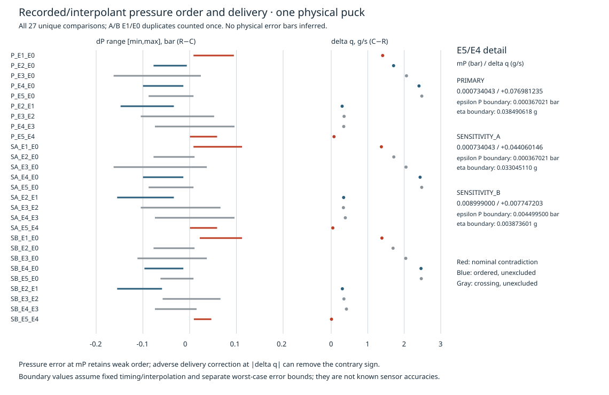

# SCI-MD-WASZ-RESTART-PRESSURE-ORDER-001

**Under the retained pressure interpolation and interval mass-observation mapping,
no common, time-independent, nondecreasing pressure-to-delivery response can
reproduce the identified interval comparisons.** Six unique nominal contradictions
concern E1/E0 and E5/E4 under the three fixed designs, all from **one physical puck**.
A reproducing model must account for the discrepancy through its pressure-response
shape, evolving state or conditions, or a supported observation contribution.
This calculation does not identify which explanation is responsible.

G1 / NO_GOVERNING_PHYSICS_CHANGE; RESEARCH_ONLY / RETROSPECTIVE / SOURCE_INTERNAL /
TARGET_EXPOSED / NONSCORING. PHYSICAL_VALIDATION=NOT_ESTABLISHED. The motivating
results were already exposed; [PLAN.md](PLAN.md) was recorded before this new
production calculation at `6195198`. Actual EWP base
`aace2cc6b6c2a393d2dbfb0274104192ca6c7203`, tree
`cb713f8229075fe4f3f1e05d1eca77868e5692ae`; current main matched the reviewed
reference. [Source identities](SOURCE_MANIFEST.json) distinguish read-only
Puckworks research main from the unchanged production dependency lock.

## Nominal order test

For every included interval I, with its declared duration D, test

\[
\bar q_I=\frac1D\int_0^D F(P_I(s))\,ds,
\]

where **one finite, time-independent, nondecreasing F** applies to all included
intervals and is otherwise unrestricted on the observed pressure domain. A finite
monotone F is measurable and bounded on the closed observed pressure range, so
these Lebesgue integrals exist. No fitted slope, continuity, smoothness, linearity,
pressure-equivalence tolerance or response fit is needed.

If P_C(s)≤P_R(s) throughout [0,D], monotonicity gives F(P_C(s))≤F(P_R(s));
integrating and dividing by the common positive D gives qbar_C≤qbar_R.
Thus delta_q=qbar_C−qbar_R>0 contradicts the hypothesis. Symmetrically,
P_C≥P_R implies delta_q≥0, so a negative contrast is contrary. Identical pressure
requires equal delivery. Equal delivery remains permitted under strict pressure
order because F may have flat portions. **One contrary pair suffices to exclude
a common F for the set; absence of a contrary pair is not an existence proof.**

Use dP(s)=P_R(s)−P_C(s). Intervals align only by elapsed time. The union contains
0,D and every internal original pressure acquisition knot of both intervals,
shifted by its own start. Both original piecewise-linear interpolants are evaluated
at every union knot. Between successive knots their difference is linear, so its
extrema occur at the segment endpoints. Exact source-decimal rational arithmetic
certifies all signs, without rounding to an inferred sensor grid or applying a
floating tolerance. This is a continuous **interpolant** certificate, not a bound
on unobserved physical pressure between acquisitions.

[PRESSURE_ORDER_WITNESSES.json](PRESSURE_ORDER_WITNESSES.json) retains all 18
intervals, normalized original support samples (time, p2, line pressure, mass),
endpoint bracket indices/weights/exactness, full union-knot pressures/differences,
segment extrema and global attaining witnesses. Original sample indices are
zero-based; rational strings are exact, with units in field names/metadata.
Bracket values and times resolve through the shared sample table. Constant
extremal segments are identified as WHOLE_SEGMENT. [RESULT.json](RESULT.json)
retains rates, signed contrasts, classifications, robustness and reconciliation;
[COMPARISONS.csv](COMPARISONS.csv) retains every reporting row and duplicate link.

| Family | Rows | Candidate lower | Candidate higher | Crossing | Identical | Unsupported / unresolved | Contrary rows |
|---|---:|---:|---:|---:|---:|---:|---:|
| A: E1–E5 later versus E0 later | 15 | 3 | 4 | 8 | 0 | 0 / 0 | 3 |
| B: E1–E5 later versus previous later | 15 | 6 | 3 | 6 | 0 | 0 / 0 | 6 |
| Unique design/pair keys | 27 | 6 | 7 | 14 | 0 | 0 / 0 | 6 |

B(E1,E0) duplicates A(E1,E0) in each design: **30 reporting rows, 3 duplicates,
27 unique comparisons, 9 contrary reporting rows and 6 unique contradictions**.
All six contrary comparisons have strictly lower candidate pressure, although
the pressure class is named CANDIDATE_WEAKLY_LOWER. The separate strict-separation
flag is true. The seven higher-pressure comparisons have higher delivery and are
order-consistent; all fourteen crossing comparisons remain unexcluded. Their
status is **NOT_EXCLUDED_BY_PAIRWISE_ORDER_TEST**, not feasible, validated or
explained by an existing F. No old early/later, initial-drift or early/reference
families were added. All class counts agree with the exposed review cross-checks.

## Conditional robustness requirements

All values below are presentation-rounded. Full exact values and raw-sample
coefficients are retained per comparison. These are **required error bounds**
under specified assumptions, not established measurement uncertainty.

| Pair | Design (D,g seconds) | mP=min(P_R−P_C), bar | delta_q, g/s | Equal separate trajectory boundary mP/2, bar | Endpoint/raw-sample eta boundary, g |
|---|---|---:|---:|---:|---:|
| E1/E0 | PRIMARY (2,2) | 0.008250000000 | +1.409188527225 | 0.004125000000 | 0.704594263612 |
| E1/E0 | SENSITIVITY_A (3,2) | 0.008250000000 | +1.374298566308 | 0.004125000000 | 1.030723924731 |
| E1/E0 | SENSITIVITY_B (2,3) | 0.021604838710 | +1.388779892473 | 0.010802419355 | 0.694389946237 |
| E5/E4 | PRIMARY (2,2) | 0.000734042553 | +0.076981235235 | 0.000367021277 | 0.038490617617 |
| E5/E4 | SENSITIVITY_A (3,2) | 0.000734042553 | +0.044060146420 | 0.000367021277 | 0.033045109815 |
| E5/E4 | SENSITIVITY_B (2,3) | 0.008999000000 | +0.007747202796 | 0.004499500000 | 0.003873601398 |

The exposed cross-check values reproduce at their supplied twelve-decimal
presentation precision; they were not producer success criteria. E5/E4 is much
smaller and window-dependent. The figure isolates its values for legibility.



For candidate-lower pressure let mP=min(P_R−P_C). If E_P bounds the adverse
differential correction e_C−e_R uniformly in aligned time, corrected difference
is at least mP−E_P. **E_P<mP preserves strict separation; E_P=mP still preserves
weak order; E_P>mP can destroy this pointwise-order certificate.** It does not
establish that a suitable F exists. For candidate-higher pressure use
mP=min(P_C−P_R) and adverse e_R−e_C symmetrically. With equal separate absolute
trajectory bounds epsilon_P, E_P≤2 epsilon_P, giving boundary mP/2. A nominal
zero-margin weak order is valid but has no positive uniform adversarial reserve.
The two pressure trajectories may have correlated errors; independence is not
assumed. These bounds concern corrections to the declared pressure trajectories.

For contrary delivery magnitude |delta_q|, an adverse differential rate correction
smaller than |delta_q| preserves its strict sign; **equality can remove the
contradiction**. For candidate-lower, the adverse direction is subtracting from
delta_q; for candidate-higher it is adding. With weak pressure order preserved,
a zero delivery difference is allowed.

With four endpoint mass errors separately bounded by |e|≤eta and fixed timing/
interpolation, the triangle inequality gives |error(delta_q)|≤4 eta/D. Thus
eta_critical=D|delta_q|/4 is the boundary of this worst-case endpoint error box.
Statistical independence is unnecessary. It is not known scale accuracy.

More precisely, write each interpolated endpoint as a weighted sum of its two
original samples. Aggregate contributions in

\[
\delta_q=\sum_j c_j m_j,\qquad
c_j=(w_{Cb,j}-w_{Ca,j}-w_{Rb,j}+w_{Ra,j})/D.
\]

Then |error(delta_q)|≤sum_j |c_j| eta_j; for uniform raw-sample bounds this is
eta sum_j |c_j|. The stored coefficients aggregate shared acquisitions **before**
taking absolute values. For every actual comparison, sum_j |c_j|=4/D: 2 s⁻¹
for PRIMARY/SENSITIVITY_B and 4/3 s⁻¹ for SENSITIVITY_A. The generic bound is
attained rather than conservative here, and raw-sample eta_critical equals the
endpoint boundary in the table. Synthetic focused tests cover cancellation and
reinforcement when observations are shared. For example, PRIMARY E1/E0 has
coefficients (1/s), all exact:

| Original sample index j | 783 | 784 | 804 | 805 | 960 | 961 | 981 | 982 |
|---|---:|---:|---:|---:|---:|---:|---:|---:|
| c_j | 73/188 | 21/188 | −6/31 | −19/62 | −73/186 | −10/93 | 6/31 | 19/62 |

A common additive mass offset cancels; a common positive mass gain preserves the
contrast sign. A common constant pressure offset and a common positive pressure
gain preserve order. Differential drift and dynamic response need not cancel.
None of these diagnostics bounds unknown sensor latency, transit, storage, timing
error or interpolation-model error. Shared observations across comparisons prevent
interpreting margins as independent experiments or as an established simultaneous
error correction explaining all comparisons.

## Retained observation contract and source

Original revision `fbc33d3380a9c8cff2467bae70fec7137a6ed46f` of
[RadostW/espresso](https://github.com/RadostW/espresso/tree/fbc33d3380a9c8cff2467bae70fec7137a6ed46f)
was authenticated against #211's retained manifest: acquisition **163,514 bytes**,
Git blob `7940d6aa008e7cae37bb1bf8ceece44fa07d0bff`, SHA-256
`e82430cde25574140d2026882a883fba21a0f0ac6d9588b15df22571836f68e9`;
plotting script **1,783 bytes**, blob
`f93c4c2abb6847d70b21df669bd6940089c226b3`, SHA-256
`aa35ade18cc8b6946164279d6e2e82337435c3165698be932ff3d0f32b47cd74`.
HEAD, pinned-tree blobs and independent byte hashes agree. No input repair or
replacement trace was used. Source failures retain unsupported diagnostics.

Attribution: Waszkiewicz, Myck, Białas, Puciata-Mroczyńska, Dzikowski, Szymczak
and Lisicki (2025), [Zenodo 18046315](https://zenodo.org/records/18046315), CC-BY-4.0
data under the established source treatment. GPLv3 plotting software was read
only for lineage, neither executed nor copied. The present producer uses Python's
standard library, the previous EWP authentication helper and an independently
implemented exact-arithmetic equivalent of its observer. The previous derivative
observer is not run. Raw payloads and full execution logs remain outside Git;
relative locators and hashes are in the manifest and [REVIEW.md](REVIEW.md).

All 1,818 original rows retain their indices and acquisition clock. Time=t/1000 s,
line pressure=p2/100 bar, cup mass=m g; other fields are uninterpreted. p1 is not
an independent puck-pressure observation; no flow-derived basket-pressure
correction is used. ACTIVE iff line pressure>5.5 bar reproduces E0–E5:
2.464–77.363, 82.974–93.913, 99.805–110.559, 117.760–128.327,
135.621–146.094 and 152.452–167.319 s. This threshold supplies support, not valve
commands or pressure equivalence. Each interval is [e−g−D,e−g].

All 18 required later intervals match the retained table's support, endpoints,
original bracket indices and exact-sample flags. Per-interval rational-versus-old
serialization differences are retained in RESULT.json, including endpoint values
and weights. Maximum absolute rate discrepancy is **1.706×10⁻¹⁴ g/s** (exact
source arithmetic minus the old serialized decimal value), an arithmetic
discrepancy only. No measurement-uncertainty estimate follows from it.

PRIMARY E1 uses 89.913–91.913 s versus E0 73.363–75.363 s; minimum dP occurs
at elapsed 1.475 s (absolute C 91.388 s, R 74.838 s). PRIMARY E5 uses
163.319–165.319 s versus E4 142.094–144.094 s, also minimizing at 1.475 s
(C 164.794 s, R 143.569 s). The union witnesses retain all supports and extrema,
including crossing cases. SENSITIVITY_B E5/E4 has its minimum at elapsed 1.260 s.

Mass delivery uses unsmoothed endpoint increments. There is no extrapolation,
missing/nonfinite support, nonincreasing clock, bridging of documented
discontinuities, interpolation gap>95 ms or episode-crossing bracket. The 95 ms
rule is an acquisition-support software rule, not a sensor-response bound.
No new window, smoothing, repair, clipping, regular grid, lag search or warping.

## Physical applicability and bounded development consequence

The exclusion concerns the **joint response and observation assumptions**.
It is conditional on recorded/interpolated line pressure, fixed timing and the
interval cup-mass mapping. Physical pressure order and instrument applicability
are not established by numerical precision. The conditional budgets above do
not supply calibrated pressure or scale uncertainty.

Fixed nonmonotone responses and pressure-driven dynamical models with memory
remain outside this exclusion. Puck rearrangement, temperature/viscosity,
dissolution, machine/valve behavior, liquid storage/transit, scale response and
ordinary time evolution are not distinguished. No interruption-specific causality,
same-record chemical exhaustion, observed channel formation or particular
permeability law is inferred. “Later” means later within the recorded active
episode, not demonstrated steady state or completed instrument/transit response.

[#211's unrestricted-F result](../sci_md_wasz_restart_response_001/RESULT.md)
remains intact: approximate pressure matching does not exclude an arbitrarily
steep or nonlinear unrestricted response. This task adds the nondecreasing
restriction and exact order implication. #207's scoped scalar theorem, #209's
terminal-mass results and producer-lineage caveat, #213's unresolved bounded
spatial result, accepted 56-brew/11-condition cohort and production dependency
lock are unchanged. Puckworks is read-only. No corpus-exhaustion, population or
independent-validation claim follows from one puck.

Retain this nominal order exclusion as a requirement for models of the recording,
with response shape, state/conditions and observation contributions still open.
No response fit, governing-law implementation, solver campaign, adoption or
automatic successor is started. PHYSICAL_VALIDATION=NOT_ESTABLISHED.

## Reproduction and verification

Explicit source acquisition is separate from the offline producer:

```bash
git init "$SOURCE_ROOT"
git -C "$SOURCE_ROOT" remote add origin https://github.com/RadostW/espresso.git
git -C "$SOURCE_ROOT" fetch --depth 1 origin fbc33d3380a9c8cff2467bae70fec7137a6ed46f
git -C "$SOURCE_ROOT" checkout --detach FETCH_HEAD
python3 tools/sci_md_wasz_restart_pressure_order_001/analyze.py \
  --source-root "$SOURCE_ROOT" --output "$OUTPUT"
PYTHONDONTWRITEBYTECODE=1 python3 -m unittest \
  tests.test_sci_md_wasz_restart_pressure_order_001 -v
```

Generated outputs are SOURCE_MANIFEST.json, COMPARISONS.csv,
PRESSURE_ORDER_WITNESSES.json, RESULT.json and PRESSURE_ORDER.svg; use an external
OUTPUT for reproduction. PLAN/RESULT prose and REVIEW are authored records.
Exact rational strings and deterministic ordering are authoritative; figure
coordinates and prose alone use rounded values. One independent scientific
review, deterministic reproduction and actual repository checks are recorded
in [REVIEW.md](REVIEW.md). Hosted outcomes and final tested head belong to the PR
handoff separately from the scientific candidate binding.
