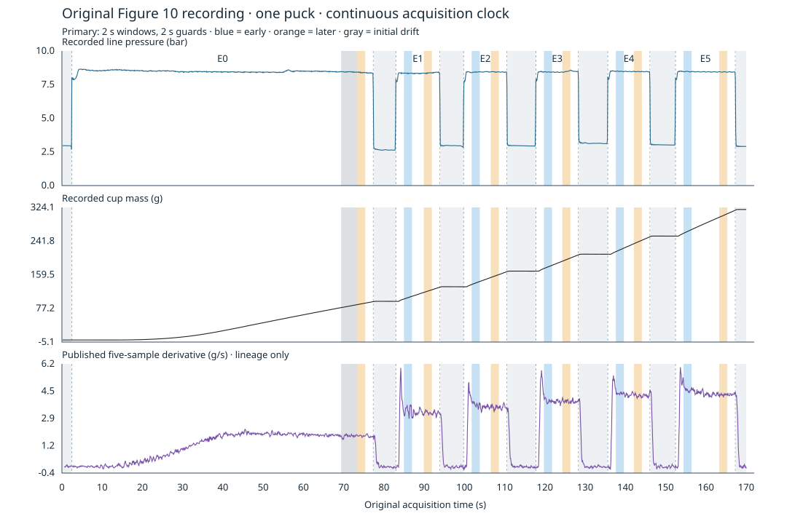

# SCI-MD-WASZ-RESTART-RESPONSE-001 result

**Later recorded beverage delivery is higher after every restart in all three
fixed designs.** The primary E0 reference is **1.823690 g/s** on
**73.363–75.363 s**; the five later restart rates are **3.232878, 3.532428,
3.885347, 4.228369 and 4.305350 g/s**, each measured over exactly **2 s**.
The corresponding cumulative differences are **+1.409189 to +2.481661 g/s**.
Later rates are below each restart's early rate, but that attenuation does
not remove the later differences from the initial reference.

Measured line-pressure trajectories are close in recorded units, but are
not equivalent by an independently justified criterion. Primary later-versus-E0
mean differences are −0.045222 to +0.072262 bar; RMS trajectory mismatches are
0.043121–0.089941 bar. Pressure-response and observation-response bounds are
not available. **Retain the quantitative within-puck observation; withhold an
interruption-specific mechanical requirement.** Mechanism and causal attribution
remain unresolved. PHYSICAL_VALIDATION=NOT_ESTABLISHED.

This completed G1 / NO_GOVERNING_PHYSICS_CHANGE analysis is RESEARCH_ONLY /
RETROSPECTIVE / SOURCE_INTERNAL / TARGET_EXPOSED, non-scoring and not a new
holdout or independent validation. There is **one physical puck**, not six
independent brews. The accepted 56-brew / 11-condition cohort is unchanged.
[PLAN.md](PLAN.md) was committed at `20f982d` before mass contrasts; it is
unchanged. Actual base: `adb50c634f0e7959eb1e5a63405ee881cde7be72`.

## 1. Recorded behavior and interval coverage

All five restarts are eligible under all three designs: 15/15 paired early/later
comparisons, 39 active intervals including nine initial drift/reference windows,
seven low-pressure context intervals, 60 A–D contrasts and six initial drift
contrasts. All intervals have original acquisition support and all early/later
pairs are nonoverlapping. No interval was shortened, moved or rescued. The
common sensitivity subset is E1–E5. A positive difference is a signed recorded
arithmetic result; it is not a calibrated effect-size or uncertainty decision.

Primary design D=2 s, g=2 s. All times use the original acquisition clock.
A = later − E0 later; B = later − previous active later; C = later − early;
D = early − E0 later. Units for rates and differences below are g/s.

| Episode | Early interval (s) | Later interval (s) | Early rate | Later rate | A | B | C | D |
|---|---|---|---:|---:|---:|---:|---:|---:|
| E1 | 84.974–86.974 | 89.913–91.913 | 3.338857 | 3.232878 | +1.409189 | +1.409189 | -0.105978 | +1.515167 |
| E2 | 101.805–103.805 | 106.559–108.559 | 3.715210 | 3.532428 | +1.708738 | +0.299549 | -0.182782 | +1.891520 |
| E3 | 119.760–121.760 | 124.327–126.327 | 3.926804 | 3.885347 | +2.061657 | +0.352919 | -0.041457 | +2.103114 |
| E4 | 137.621–139.621 | 142.094–144.094 | 4.369242 | 4.228369 | +2.404679 | +0.343022 | -0.140873 | +2.545552 |
| E5 | 154.452–156.452 | 163.319–165.319 | 4.588719 | 4.305350 | +2.481661 | +0.076981 | -0.283368 | +2.765029 |

E1's B duplicates A exactly and adds no independent evidence. The successive
later increments are positive in all designs, but the final E5–E4 increment is
window dependent: +0.076981, +0.044060 and +0.007747 g/s for primary, A and B.
The last value is not evidence of physical equivalence or return to baseline.
All early-versus-baseline contrasts are also positive; later-minus-early
contrasts are negative in all 15 comparisons. This record supports both
within-episode attenuation and later cumulative differences, rather than an
early-only pattern. "Later" means later within the recorded active episode,
not steady state or demonstrated completion of storage/scale/transit effects.

Fixed sensitivity A: D=3 s, g=2 s; B: D=2 s, g=3 s. No Cartesian expansion.
The E0 references are 1.833255 g/s on 72.363–75.363 s and 1.836917 g/s on
72.363–74.363 s respectively. All full-precision intervals, component rates,
signed contrasts and pressure histories are in [RESULT.json](RESULT.json),
[INTERVALS.csv](INTERVALS.csv) and [CONTRASTS.csv](CONTRASTS.csv).

| Design | Episode | Later rate (g/s) | A (g/s) | B (g/s) | C (g/s) | D (g/s) |
|---|---|---:|---:|---:|---:|---:|
| SENSITIVITY_A | E1 | 3.207553 | +1.374299 | +1.374299 | -0.096435 | +1.470734 |
| SENSITIVITY_A | E2 | 3.547694 | +1.714439 | +0.340141 | -0.089824 | +1.804263 |
| SENSITIVITY_A | E3 | 3.882086 | +2.048832 | +0.334392 | -0.022220 | +2.071051 |
| SENSITIVITY_A | E4 | 4.268380 | +2.435125 | +0.386293 | -0.056417 | +2.491541 |
| SENSITIVITY_A | E5 | 4.312440 | +2.479185 | +0.044060 | -0.238754 | +2.717939 |
| SENSITIVITY_B | E1 | 3.225697 | +1.388780 | +1.388780 | -0.036913 | +1.425693 |
| SENSITIVITY_B | E2 | 3.531058 | +1.694141 | +0.305361 | -0.051775 | +1.745916 |
| SENSITIVITY_B | E3 | 3.879584 | +2.042667 | +0.348526 | -0.018391 | +2.061058 |
| SENSITIVITY_B | E4 | 4.296915 | +2.459998 | +0.417331 | -0.023169 | +2.483167 |
| SENSITIVITY_B | E5 | 4.304662 | +2.467745 | +0.007747 | -0.219308 | +2.687053 |

The observed active support ends at 167.319 s; selected later intervals end
at most at 165.319 s. Across the designs, E1 later begins at 88.913 or
89.913 s; E5 later begins at 162.319 or 163.319 s. Exact episode-relative
positions follow from the retained episode boundaries. A 2- or 3-second
guard is a design choice, not an instrument-response bound.

Exactly three initial late-brew intervals supply descriptive drift context:

| Design | Three intervals (s), in order | Three rates (g/s) | Consecutive differences (g/s) |
|---|---|---|---|
| PRIMARY | 69.363–71.363; 71.363–73.363; 73.363–75.363 | 1.815994, 1.847292, 1.823690 | +0.031299, -0.023602 |
| SENSITIVITY_A | 66.363–69.363; 69.363–72.363; 72.363–75.363 | 1.862902, 1.824729, 1.833255 | -0.038173, +0.008526 |
| SENSITIVITY_B | 68.363–70.363; 70.363–72.363; 72.363–74.363 | 1.797912, 1.848485, 1.836917 | +0.050574, -0.011569 |

These local drift changes are smaller in recorded units than the cumulative
restart contrasts. They do not identify the later trajectory of an
uninterrupted brew: no trend was fitted or extrapolated and no appropriate
uninterrupted control is furnished.

## 2. Acquisition authentication, transitions and low-pressure mass

The pinned original revision is `fbc33d3380a9c8cff2467bae70fec7137a6ed46f`.
Both acquisition and plotting-script Git blobs match the expected identities;
independent SHA-256, byte sizes, attribution and retrieval are in
[SOURCE_MANIFEST.json](SOURCE_MANIFEST.json). The raw 1,818-row JSON-lines
acquisition spans 0.126–170.031 s, with adjacent intervals of 0.093–0.095 s.
`t/1000` is seconds, `p2/100` is measured line pressure in bar, and `m` is
recorded cup mass in grams. All seven fields are present and finite in every
row; other fields remain uninterpreted. In particular, p1 is not asserted to
be an independent puck-pressure measurement.

There are no duplicate/nonincreasing timestamps or gaps outside the inspected
cadence. The 314 negative mass steps are retained; 1,499 steps are positive
and four are zero. Signed extremes are −0.063900 g at original indices
1065→1066 (99.711→99.805 s) and +0.822800 g at 1639→1640
(153.387→153.481 s). No discontinuity is documented in the inspected record.
This does not establish that the scale was never handled or that its response
is instantaneous. No mass repair, clipping or monotonic correction was applied.
The acquisition audit retains negative-step locations; all mass endpoints retain
original indices, values, brackets, widths, fractions and exactness.

Pressure alone defines ACTIVE >5.5 bar; first and last active samples define
each span. Original transition brackets are retained in [EPISODES.csv](EPISODES.csv).
Every transition has an acquisition on both sides (93–95 ms apart). These
brackets are not measured valve-command times. The threshold separates the
observed states; it is neither a flowing-puck pressure threshold nor a
pressure-equivalence criterion.

| Active episode | First–last active (s) | Supported duration (s) | Line-pressure range (bar) |
|---|---|---:|---|
| E0 | 2.464–77.363 | 74.899 | 6.979999–8.654750 |
| E1 | 82.974–93.913 | 10.939 | 6.224750–8.439500 |
| E2 | 99.805–110.559 | 10.754 | 6.324500–8.471000 |
| E3 | 117.760–128.327 | 10.567 | 7.792250–8.576750 |
| E4 | 135.621–146.094 | 10.473 | 7.451750–8.533250 |
| E5 | 152.452–167.319 | 14.867 | 7.864250–8.510750 |

All low-pressure periods, including the initial and final ones, are retained.
Mass changes below are between first and last low-pressure samples, excluding
the transition brackets; they are supported observations, not a storage
correction or direct puck-throughput measurement.

| Low-pressure episode | Support (s) | Duration (s) | Pressure range (bar) | Mass change (g) |
|---|---|---:|---|---:|
| L0 | 0.126–2.371 | 2.245 | 2.672000–2.968250 | +0.012495 |
| L1 | 77.457–82.880 | 5.423 | 2.621000–4.252250 | +0.566580 |
| L2 | 94.006–99.711 | 5.705 | 2.849750–3.092000 | +0.732900 |
| L3 | 110.654–117.667 | 7.013 | 2.934500–4.508000 | +1.009200 |
| L4 | 128.420–135.528 | 7.108 | 3.113000–3.636500 | +1.178300 |
| L5 | 146.187–152.359 | 6.172 | 3.010250–4.382750 | +1.230800 |
| L6 | 167.413–170.031 | 2.618 | 2.898500–3.959750 | +1.297000 |

L1–L5 are the intervening pressure-off periods. Their positive recorded mass
changes are consistent with several storage/dripping/transit/measurement
explanations, without selecting one. The source describes closed valves near
3 bar and possible backflow. That is not an applied 3-bar pressure drop through
a flowing puck, and it does not require cup mass to stop changing.



## 3. Pressure comparability and the conditional model implication

Every interval retains original pressure support, piecewise-linear history,
time-weighted mean, extrema, sample-weighted quartiles, net endpoint change,
total variation and maximum excursion from its mean. Every contrast retains
mean-pressure difference and RMS/maximum trajectory mismatch. Equal-duration
trajectories are compared on the union of original relative-time knots, without
warping or selecting pressure-matched replacements. The squared difference is
integrated analytically on every linear segment; this is not mean-only matching.

Primary later intervals versus initial E0 (mean 8.402228 bar):

| Episode | Later mean (bar) | Min–max (bar) | Net change (bar) | Mean difference (bar) | RMS mismatch (bar) | Maximum mismatch (bar) |
|---|---:|---|---:|---:|---:|---:|
| E1 | 8.357005 | 8.314250–8.387000 | +0.032822 | -0.045222 | 0.054313 | 0.094627 |
| E2 | 8.446999 | 8.413250–8.471000 | +0.002370 | +0.044771 | 0.047475 | 0.077249 |
| E3 | 8.474490 | 8.408000–8.547766 | +0.128005 | +0.072262 | 0.089941 | 0.162702 |
| E4 | 8.466310 | 8.447000–8.486000 | -0.002246 | +0.064082 | 0.066783 | 0.099750 |
| E5 | 8.439624 | 8.420000–8.466500 | -0.029620 | +0.037397 | 0.043121 | 0.087750 |

For A contrasts across all three designs, mean differences span −0.080380 to
+0.072262 bar and RMS mismatch spans 0.023002–0.089941 bar. Within-restart C
comparisons have RMS mismatch 0.016394–0.063356 bar; the full B/D diagnostics
are also retained. The histories are not identical; the near equality of
some means cannot establish physical pressure equivalence. Pressure uncertainty
and response slope are uncalibrated, and no effect-driven tolerance is introduced.

The specified candidate is a **time-invariant, memoryless q(t)=F(P_line(t))**
with stable apparatus, observation response and other relevant conditions.
For a nonlinear F, its interval prediction is the average of F(P_line(t)),
not F of the mean pressure. If independent bounds made these pressure
trajectory differences and observation effects too small to account for the
recorded delivery differences, this pattern would challenge that fixed-state
description. Such bounds are not supplied here. Approximate pressure matching
does not reject an unrestricted, arbitrarily steep or nonlinear F. Quantitative
exclusion of pressure effects is therefore **unresolved**, despite the supported
arithmetic and consistent signs. No F was fitted, no cohort slope transferred,
and no q/P ratio or flow-derived basket pressure was used.

A model intended to reproduce the recording must reproduce relevant recorded
mass increments through an appropriate observation operator. Failure of the
specified description under additional justified assumptions would require
revisiting its state/condition/observation assumptions; it would not by itself
locate a state change in the puck or require a particular permeability law.

## 4. Physical and causal attribution

Puck rearrangement/permeability evolution, continued dissolution,
temperature/viscosity changes, liquid storage/release and transit, valve/machine
behavior, scale/instrument response, and ordinary evolution with elapsed brewing
time remain plausible contributors that this recording does not separate.
The [paper's apparatus and Figure 10 discussion](https://arxiv.org/html/2512.21528v1)
provide context for pressure cycling and cup measurement; their interpretations
are not extra observed channels. In particular:

- No demonstrated same-record chemical-exhaustion measurement supports a
  "no additional dissolution" constraint. Separate TDS measurements or the
  proposed rebrew protocol do not supply that missing join.
- Separate CT images and the Figure 10 interpretation do not establish
  observed channel formation within this acquisition.
- Without an appropriate uninterrupted control, interruption cannot be isolated
  as the causal source: pressure cycling, elapsed time and cumulative delivery
  evolve together. The three initial windows do not remove that confounding.
- Numerical precision, software correctness, measurement uncertainty and
  practical effect size remain separate. Instrument/interpolation uncertainty
  is uncalibrated; timestamp and mass decimal precision are not sensor accuracy.
  No error distribution, population claim, episode-level p-value or row bootstrap
  is introduced.

PR #207's scalar impossibility theorem stands within its assumptions, including
its observation and initial-state applicability limits. This one-puck record
neither overturns it nor adjudicates full spatial/stochastic Mo2021. PR #209's
terminal-mass signs, accepted cohort and historical producer-lineage caveat
are preserved. No prior score, threshold, observation or result was replaced.

## 5. Source-observer lineage, reproduction and verification

The published observer is independently reconstructed as a trailing five-sample
mean of m followed by an adjacent difference divided by the current adjacent
time difference. Means are missing at rows 0–3; derivatives at rows 0–4.
An independent direct formula, (m[i]−m[i−5])/(5*dt[i]), agrees to at most
7.34e−13 g/s (floating arithmetic, not measurement uncertainty). On irregular
timestamps this differs from the five-interval mass change divided by its total
elapsed time. The separate derivative panel is lineage/visualization only;
its maxima were not used. The primary observer uses unsmoothed mass endpoints
only; there is no pressure alignment, 100-second truncation, SG filter or
historical endpoint producer imported from #209.

Data attribution: Waszkiewicz et al. (2025), [Zenodo deposit 18046315](https://zenodo.org/records/18046315),
CC-BY-4.0 data under the established source treatment. Accompanying source
software is GPLv3; inspected but not copied or executed. Raw payloads and full
logs remain external. Python 3.12.3, standard library only; no production
runtime/dependency lock change. Reproduce into an external output directory:

```bash
git init "$SOURCE_ROOT"
git -C "$SOURCE_ROOT" remote add origin https://github.com/RadostW/espresso.git
git -C "$SOURCE_ROOT" fetch --depth 1 origin fbc33d3380a9c8cff2467bae70fec7137a6ed46f
git -C "$SOURCE_ROOT" checkout --detach FETCH_HEAD
python3 tools/sci_md_wasz_restart_response_001/analyze.py   --source-root "$SOURCE_ROOT" --output "$OUTPUT"
PYTHONDONTWRITEBYTECODE=1 python3 -m unittest tests.test_sci_md_wasz_restart_response_001 -v
```

The script checks revision, Git blobs and independent byte hashes, preserving
an authentication diagnostic instead of substituting another trace on mismatch.
Machine-readable outputs use available full float precision with explicit nulls
and unavailable reasons; rounding is confined to this report and the figure.
[CHECKS.json](CHECKS.json) records local checks and deterministic reproduction;
[REVIEW.md](REVIEW.md) records the independent scientific review and reviewed
candidate. Final-head hosted CI and PR lifecycle are reported in the PR handoff,
separately from the scientific result. The review is independent AI review,
not an independent experiment or a human GitHub approval.

**Development consequence:** retain the supported later within-puck delivery
increases as a quantitative source-internal observation, including the early
attenuation and pressure histories. Withhold an interruption-specific mechanical
requirement because pressure-response, apparatus/observation comparability and
ordinary-time evolution remain unresolved. No successor, fit, solver adoption,
production change or laboratory action is started.
