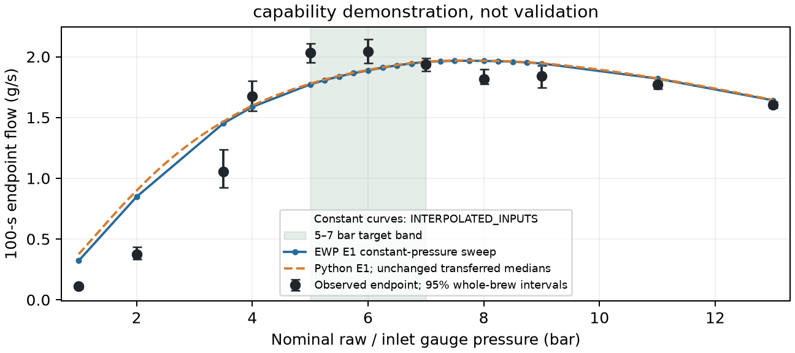

# E1 capability demonstration

**capability demonstration, not validation. PHYSICAL_VALIDATION=NOT_ESTABLISHED.**
SOURCE_SCENARIO_CHANGE_ONLY; TARGET_EXPOSED: transferred medians combine fits exposed to these brews. No refitting.

23 constant cases + 56 histories; R0, raw line → inlet gauge pressure, 100-s stable clock, 0.0025-s steps, 32 ranks sequentially. Numerical sanity checks qualify.

| Forcing | Endpoint RMSE (% vs B1), g/s | Trace RMSE: primary / full window, g/s | Accuracy | Nominal peak [95%], bar | Slope ≥9 bar [95%], g/s/bar |
|---|---|---|---|---|---|
| Constant | 0.206 (-28.1%) | 0.325 / 0.374 | NEAR (UNRESOLVED) | 8 [8.0, 8.0] — NEAR | -0.0757 [-0.0757, -0.0757] — MEETS |
| Measured histories | 0.201 (-29.7%) | 0.321 / 0.369 | NEAR (UNRESOLVED) | 8 [8.0, 8.0] — NEAR | -0.0748 [-0.0754, -0.0742] — MEETS |
| B0c B1 reference | 0.286 | 0.456 / 0.621 | N/A (reference) | — | — |

Owner’s bands unchanged. Intervals: 1,000 paired, condition-balanced whole-brew resamples, seed 20261103; fixed predictions, zero-width constant-forcing response intervals. Primary trace: observed onset+2 through 100 s; secondary 5–100 s, ungraded: **includes start-up; Python E1 has no wetting phase**. B1 uses identical masks. Observed onset defines the scoring window only; it is never a model input, parameter or endpoint-grade input. [Full scores](GRADES.csv).

After the wetting offset, the largest CFD–Python difference at nominal constant pressures is about 2.4e-05 g/s. The solver peak remains late: three-point quadratic interpolation gives **7.714 bar**, versus observed **6.1 [5.9, 6.3] bar**. Measured histories change endpoint RMSE from 0.206 to 0.201 g/s.
Including start-up makes the solver-minus-B1 trace-RMSE gap 0.118 g/s smaller (constant) and 0.117 g/s smaller (histories); the wetting-offset split below isolates its 100-s effect.

Wetting uses R0 permeability (1.77e-15 m²); E1 starts only at `e1Enabled && saturatedAtStepStart`. Delayed Python (M=0/zero flow until saturation) explains 99.9% of the summed absolute nominal constant-pressure gap; the largest 4–8 bar offset is -0.01043 g/s at 4 bar. [Endpoints, saturation and M(100)](ENDPOINTS.csv); [start-up split](PYTHON_SOLVER_DIFFERENCES.csv).

On the common stable-pressure clock, sharp-front first-drip ranges overlap observed onset at 1, 2 bar but are earlier at 3.5, 4, 5, 6, 7, 8, 9, 11, 13 bar; observed medians are 11.1–13.0 s at 3.5–6 bar, rising to 17.9 s at 13 bar ([ungraded comparison](FIRST_DRIP_BY_PRESSURE.csv); [clocks](FIRST_DRIP_BY_BREW.csv)).

Early-pressure inputs: training-fold interpolants (**INTERPOLATED_INPUTS**) for constant cases; measured 0–2-s medians for histories.

**Recommended next step:** Owner: review whether the retained peak-location limitation is acceptable for this capability use before authorizing any further solver work.

Native compute: 17.903 h / 572.90 core-hours. [Manifest; native outputs outside Git](RUN_MANIFEST.json). Waszkiewicz et al. (2025), [Zenodo 18046315](https://doi.org/10.5281/zenodo.18046315), CC-BY-4.0; Puckworks `ba35a3bf` [B0c](https://github.com/trbrewer/puckworks/blob/ba35a3bf1f832cd651fe98eebd59860849c0e850/docs/research/PRESSURE_PEAK_STAGE_B0C/RESULT_TABLE.csv) / [scorecard bands](https://github.com/trbrewer/puckworks/blob/ba35a3bf1f832cd651fe98eebd59860849c0e850/docs/research/PRESSURE_PEAK_SCORECARD/SUMMARY.md).
